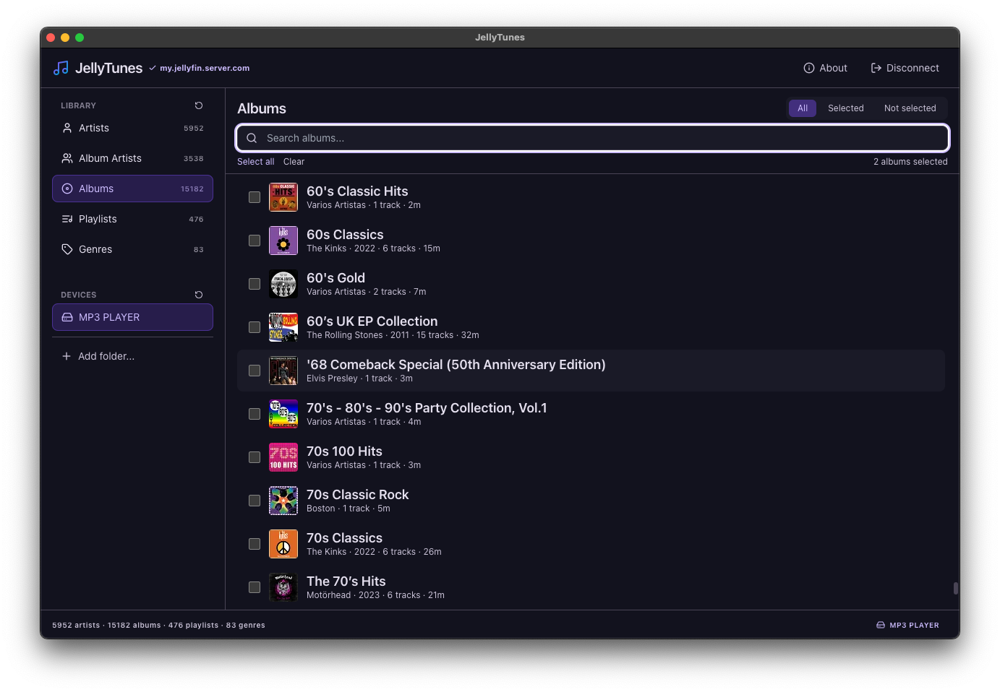
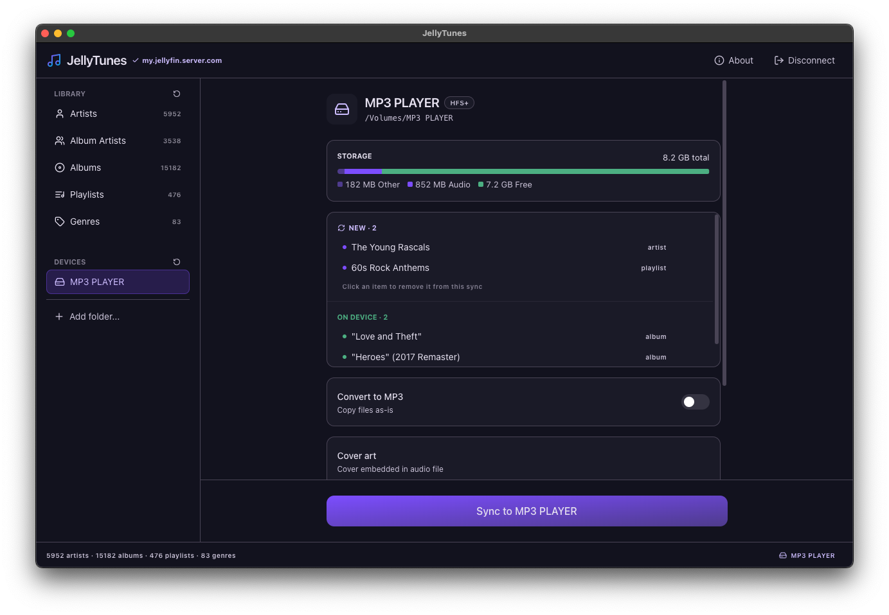
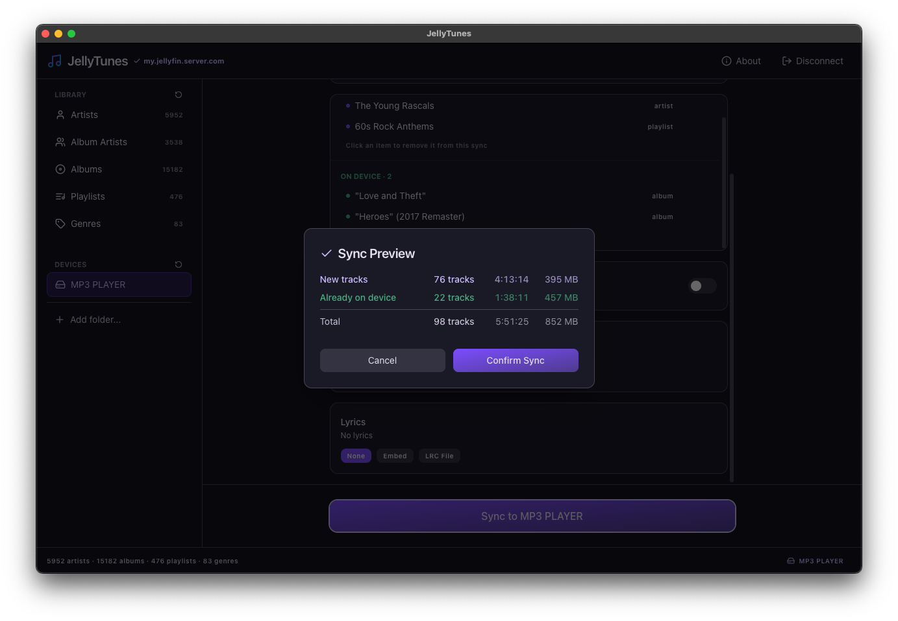
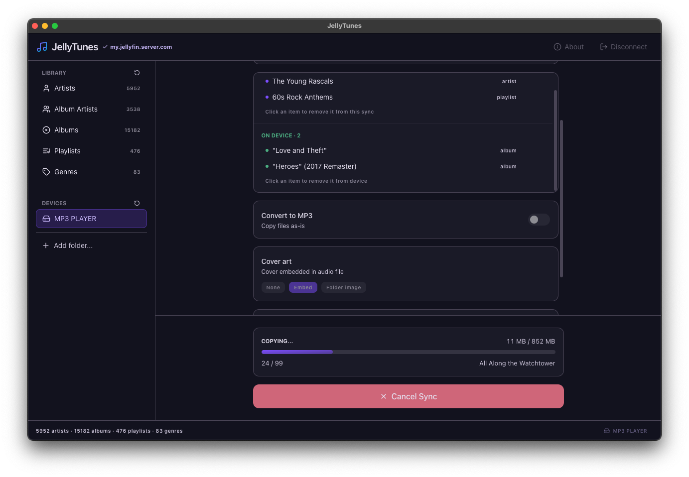

<p align="center">
  
</p>

<h1 align="center">JellyTunes</h1>

<p align="center">
  Take your Jellyfin music offline on MP3 players and storage devices.
</p>

<p align="center">
  <a href="https://github.com/orainlabs/jellytunes/releases/latest"></a>
  &nbsp;
  <a href="https://www.gnu.org/licenses/gpl-3.0"></a>
</p>

<p align="center">
  <a href="https://ko-fi.com/orainlabs"></a>
</p>

---

JellyTunes is a desktop app for [Jellyfin](https://jellyfin.org) users who want their music offline. Browse the artists, album artists, albums, playlists and genres on your server, pick a destination such as an MP3 player, a USB drive, an SD card or any local folder, and hit sync. JellyTunes downloads the tracks, converts formats when needed, embeds lyrics and cover art, and mirrors your server's folder structure at the destination.

## Key Features

- **Browse your full library** — artists, album artists, albums, playlists, and genres pulled directly from your Jellyfin server
- **Sync anywhere** — USB drives, SD cards, and local folders all work as destinations
- **Selective sync** — only downloads what's new or changed; skips tracks already at the destination
- **Out-of-sync detection** — tracks that changed on the server since the last sync are automatically flagged for update
- **Sync preview** — a three-column breakdown of exactly what will be added, updated, or removed — with per-category track count, size, and duration — before you commit to a sync
- **FLAC to MP3 conversion** — built-in FFmpeg support with configurable bitrate (128k / 192k / 320k); settings saved per device
- **Legacy ID3 tags** — write MP3 tags as ID3v2.3 for older players that cannot read ID3v2.4 (for example Sony Walkman models); configurable per device, and switching modes re-tags files already on the device
- **Lyrics sync** — download `.lrc` sidecar files or embed lyrics directly into tracks (supports Jellyfin 10.9+ JSON lyrics); mode is configurable per device
- **Cover art modes** — embed cover art into each track or write companion `cover.jpg` files; chosen per device and persisted
- **ReplayGain tags** — ReplayGain metadata from Jellyfin is embedded into synced tracks for consistent playback volume
- **Smart storage bar** — visual capacity indicator with live size estimates; warns when your selection exceeds free space
- **Smart filesystem handling** — auto-detects FAT32, exFAT, and NTFS; sanitizes filenames accordingly
- **Per-destination history** — remembers what was synced to each device or folder so you can pick up where you left off
- **Cancel anytime** — stop a sync mid-progress without corrupting what's already been written

## Screenshots

<p align="center">
  <a href="assets/screenshot-albums.png"></a>
  &nbsp;&nbsp;
  <a href="assets/screenshot-device.png"></a>
</p>
<p align="center">
  <em>Browse your library &nbsp;·&nbsp; Pick a destination device or folder</em>
</p>

<p align="center">
  <a href="assets/screenshot-sync-preview.png"></a>
  &nbsp;&nbsp;
  <a href="assets/screenshot-syncing.png"></a>
</p>
<p align="center">
  <em>Review what will change &nbsp;·&nbsp; Sync with live, phase-aware progress</em>
</p>

## Installation

<!-- Store badges. Additional stores (Flathub, etc.) slot in here as siblings —
     keep them inside this same <p> so the row stays centered and wraps cleanly. -->
<p align="center">
  <a href="https://snapcraft.io/jellytunes">
    <picture>
      <source media="(prefers-color-scheme: dark)" srcset="https://snapcraft.io/en/light/install.svg" />
      
    </picture>
  </a>
</p>

<p align="center">
  <sub><b>Linux</b> &nbsp;·&nbsp; installs in one command, updates arrive on their own</sub>
</p>

<br />

Prefer a direct download? Every platform is built on each release — grab yours from [the latest release](https://github.com/orainlabs/jellytunes/releases/latest):

| Platform    | File        | Notes                                                                            |
| ----------- | ----------- | -------------------------------------------------------------------------------- |
| **macOS**   | `.dmg`      | Apple silicon and Intel                                                          |
| **Windows** | `.exe`      | Installer                                                                        |
| **Linux**   | `.deb`      | Debian and Ubuntu                                                                |
| **Linux**   | `.AppImage` | AppImage (legacy) — see [Linux installation and migration](docs/INSTALLATION.md) |

Open the installer and follow the prompts. FFmpeg is bundled with every package, so there is nothing else to install.

### Linux: install from the Snap Store

```bash
sudo snap install jellytunes
```

The `.snap` is not attached to the release on purpose: a file downloaded from GitHub carries no store signature and `snap install` will reject it. Use the Snap Store button above, or the command.

Syncing to USB drives and SD cards needs the `removable-media` interface. Most systems connect it on install; if yours doesn't, JellyTunes says so at startup and gives you the command.

The `.deb` is equally supported and runs unconfined, which matters if your desktop has no working Secret portal and JellyTunes keeps asking you to log in. AppImage still runs but is deprecated. Both cases, and the migration path off AppImage, are covered in [Linux installation and migration](docs/INSTALLATION.md).

### macOS: "App is damaged" or Gatekeeper warning

macOS blocks JellyTunes the first time you open it. What it says depends on your Mac:

| Your Mac                         | What you see                                                                  |
| -------------------------------- | ----------------------------------------------------------------------------- |
| **Apple silicon** (M1 and later) | _"JellyTunes is damaged and can't be opened. You should move it to the Bin."_ |
| **Intel**                        | _"JellyTunes can't be opened because it is from an unidentified developer."_  |

**On Apple silicon, "damaged" does not mean the download is broken.** It is the wording macOS uses for any quarantined app it cannot verify, and JellyTunes cannot be verified because it is not signed with an Apple Developer certificate. Mac OS builds have been confirmed to install and run on Apple silicon after the steps below.

Click **Cancel**, not **Move to Bin**, and then:

1. Open the `.dmg` and drag **JellyTunes** into your **Applications** folder.
2. Open **Terminal** and run:
   ```bash
   xattr -cr /Applications/JellyTunes.app
   ```
3. Open JellyTunes normally.

That command clears the `com.apple.quarantine` flag your browser attaches to anything it downloads. You need it once per install, and again after each update.

On **Intel** Macs you can avoid Terminal: try to open the app, then go to **System Settings → Privacy & Security** and click **"Open Anyway"** next to the JellyTunes entry. Apple silicon usually offers no such button for the "damaged" error, so use the command above.

Signing the app so macOS stops asking requires a paid Apple Developer account, which JellyTunes does not have yet. Until then this step is unavoidable — it is not a bug. See [issue #12](https://github.com/orainlabs/jellytunes/issues/12) for the background.

### Windows: "Windows protected your PC" (SmartScreen)

JellyTunes is not signed with a code-signing certificate, so Windows SmartScreen may show a blue **"Windows protected your PC"** warning the first time you run the installer. To proceed:

1. Click **"More info"** on the warning dialog
2. Click the **"Run anyway"** button that appears
3. Continue through the installer as normal

This only happens on first run.

### Prerequisites

- A [Jellyfin](https://jellyfin.org) server reachable on your network
- A USB drive, SD card, local folder, or any mounted storage device as destination

---

## Development

Everything below is for contributors and developers who want to build JellyTunes from source.

### Setup

```bash
git clone https://github.com/orainlabs/jellytunes.git
cd jellytunes
pnpm install
pnpm dev
```

This starts the Vite dev server and launches the Electron window.

**Requirements**: Node.js 18+ and [pnpm](https://pnpm.io)

### Commands

```bash
# Development
pnpm dev              # Start dev server + Electron
pnpm build            # Compile with electron-vite
pnpm typecheck        # TypeScript type checking

# Testing
pnpm test             # Unit tests (Vitest)
pnpm test:unit:watch  # Unit tests in watch mode
pnpm test:e2e         # E2E tests with Playwright (see docs/E2E_TESTING.md)

# Packaging
pnpm package          # Build + create installers
```

### Architecture

Three Electron processes plus a standalone sync engine:

- **Main process** (`src/main/`) — IPC handlers, USB/filesystem detection, sync orchestration
- **Preload** (`src/preload/`) — typed IPC bridge between main and renderer
- **Renderer** (`src/renderer/`) — React UI for library navigation, device selection, and sync progress
- **Sync module** (`src/sync/`) — dependency-injected sync engine (API client, file ops, FFmpeg converter); fully unit-testable without hitting the network or filesystem

### Contributing

See [CONTRIBUTING.md](CONTRIBUTING.md) for guidelines on reporting bugs, submitting changes, and code style.

## License

This project is licensed under the GNU General Public License v3.0 — see the [LICENSE](LICENSE) file for details.
